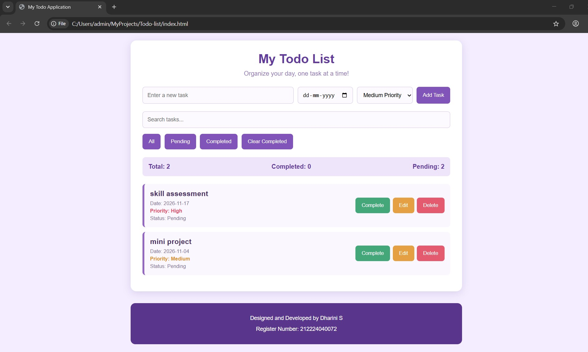
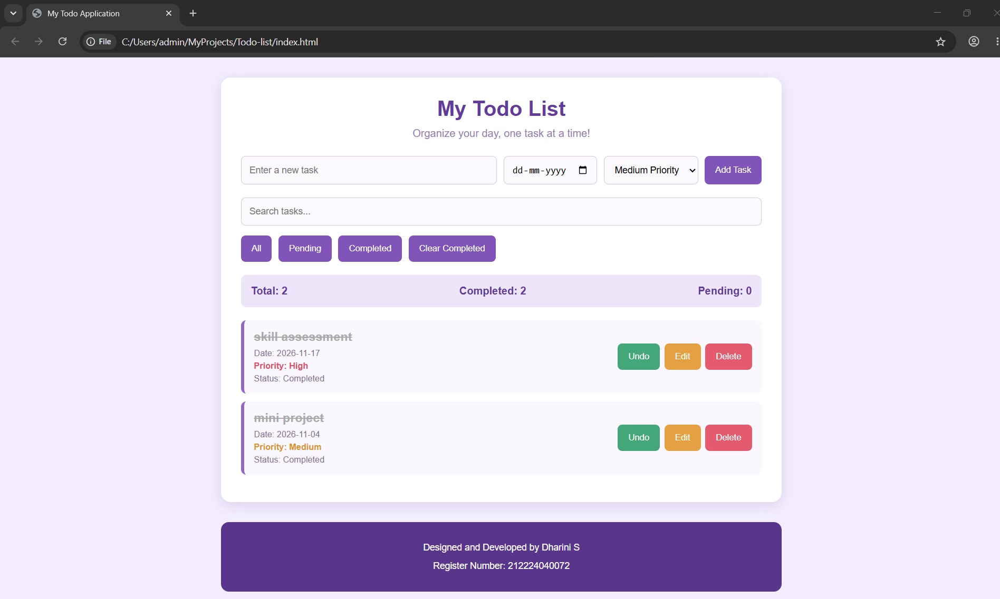

# Ex03 To-Do List using JavaScript
## Date:3.11.2026

## AIM
To create a To-do Application with all features using JavaScript.

## ALGORITHM
### STEP 1
Build the HTML structure (index.html).

### STEP 2
Style the App (style.css).

### STEP 3
Plan the features the To-Do App should have.

### STEP 4
Create a To-do application using Javascript.

### STEP 5
Add functionalities.

### STEP 6
Test the App.

### STEP 7
Open the HTML file in a browser to check layout and functionality.

### STEP 8
Fix styling issues and refine content placement.

### STEP 9
Deploy the website.

### STEP 10
Upload to GitHub Pages for free hosting.

## PROGRAM

```

<!DOCTYPE html>
<html lang="en">
<head>
    <meta charset="UTF-8">
    <meta name="viewport" content="width=device-width, initial-scale=1.0">
    <title>My Todo Application</title>
    <link rel="stylesheet" href="style.css">
</head>
<body>

    <div class="container">

        <h1>My Todo List</h1>
        <p class="subtitle">Organize your day, one task at a time!</p>

        <div class="input-section">
            <input type="text" id="taskInput" placeholder="Enter a new task">
            <input type="date" id="taskDate">

            <select id="taskPriority">
                <option value="Low">Low Priority</option>
                <option value="Medium" selected>Medium Priority</option>
                <option value="High">High Priority</option>
            </select>

            <button onclick="addTask()">Add Task</button>
        </div>

        <input type="text" id="searchInput"
               placeholder="Search tasks..."
               oninput="displayTasks()">

        <div class="filters">
            <button onclick="setFilter('All')">All</button>
            <button onclick="setFilter('Pending')">Pending</button>
            <button onclick="setFilter('Completed')">Completed</button>
            <button onclick="clearCompleted()">Clear Completed</button>
        </div>

        <div class="task-stats">
            <span id="totalTasks">Total: 0</span>
            <span id="completedTasks">Completed: 0</span>
            <span id="pendingTasks">Pending: 0</span>
        </div>

        <div id="taskList"></div>

    </div>

    <footer>
        
        <p>Designed and Developed by Dharini S</p>
        <p>Register Number: 212224040072</p>
        
    </footer>

    <script src="script.js"></script>

</body>
</html>
```

## OUTPUT



## RESULT
The program for creating To-do list using JavaScript is executed successfully.
